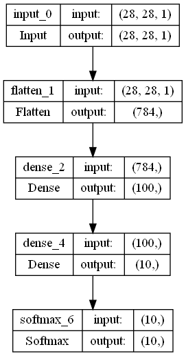
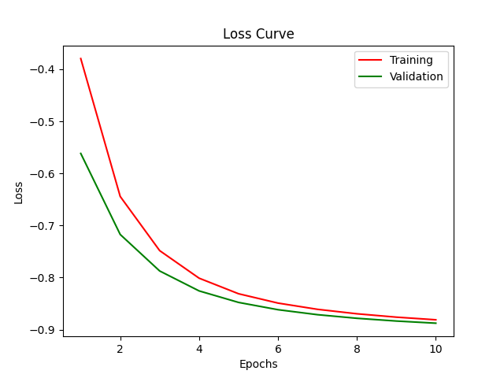
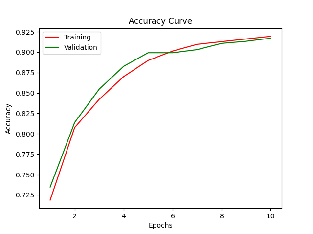

<div align="center">
    
</div>

# Sunstreaker  

源码清晰明了，使用简单好搞


## 目标

- [x] 源码清晰简洁，利于算法学习与实验
- [x] 快速实验新改进想法
- [x] 快速复现新论文
- [ ] 快速分布式训练一个大模型
- [x] 快速使用开源模型权重（Qwen3 / Qwen3-MoE）


## 说明

* 本项目采用小步快走的形式，欢迎start，但不建议fork，因为<font color="red" size=4>更新速度比较快</font>。
* 本项目用于学习与实验，切勿用于生产

## 欢迎关注公众号：无数据不智能

<div align="center">
    
</div>

## 安装
> tensorflow只是加载demo数据需要，也可以不装


> jax 0.12.0 需要 Python 3.12 及以上

### windows

1. 安装jax
   * cpu
   ```
   pip install --upgrade "jax[cpu]==0.12.0"
   ```
   * gpu
   Windows 原生暂不提供 CUDA 版本的 jax 轮子，请使用 WSL2 或 Linux 环境安装：
   ```
   pip install --upgrade "jax[cuda12]==0.12.0"
   ```
2. 安装Graphviz
   * [exe安装下载](http://graphviz.org/download/)
   * pygraphviz（安装 Graphviz 后执行）
   ```
   pip install pygraphviz
   ```
3. pip install -r requirements.txt
4. pip install sunstreaker
### linux
1. 安装jax

   - cpu

   ```
   pip install --upgrade "jax[cpu]==0.12.0"
   ```

   - gpu

   ```
   pip install --upgrade "jax[cuda12]==0.12.0"
   ```

2. [安装Graphviz](http://graphviz.org/download/)

3. pip install -r requirements.txt

4. pip install sunstreaker


## 使用


### 用tensorflow_datasets搞些数据

```python
import tensorflow as tf

tf.config.set_visible_devices([], 'GPU')
import math
import asyncio
import tensorflow_datasets as tfds
from sunstreaker.data import Dataloader
from sunstreaker.layers import Flatten
from sunstreaker.layers.activations import Softmax
import jax.numpy as jnp
from sunstreaker.losses import categorical_crossentropy
from sunstreaker.metrics import categorical_accuracy
from sunstreaker.optimizers import RMSProp


def load(batch_size: int, func):
   async def tfds_load_data() -> Dataloader:
      ds, info = tfds.load(name="mnist", split=["train", "test"], as_supervised=True, with_info=True,
                           shuffle_files=True, batch_size=batch_size)
      train_ds, valid_ds = ds
      train_ds, valid_ds = func(train_ds), func(train_ds)
      train_ds, valid_ds = train_ds.cache().repeat(), valid_ds.cache().repeat()
      input_shape = tuple(list(info.features["image"].shape))
      num_train_batches = math.ceil(info.splits["train"].num_examples / batch_size)
      num_val_batches = math.ceil(info.splits["test"].num_examples / batch_size)
      return Dataloader(
         train_data=iter(tfds.as_numpy(train_ds)), val_data=iter(tfds.as_numpy(valid_ds)),
         input_shape=input_shape, batch_size=batch_size,
         num_train_batches=num_train_batches, num_val_batches=num_val_batches
      )

   return asyncio.run(tfds_load_data())


def load_dataset(batch_size: int):
   def func(ds):
      return ds.map(lambda x, y: (tf.divide(tf.cast(x, dtype=tf.float32), 255.0), tf.one_hot(y, depth=10)))

   return asyncio.run(load(batch_size, func))


def load_dataset_muti(batch_size: int):
   def func(ds):
      return ds.map(lambda x, y: ({"img": tf.divide(tf.cast(x, dtype=tf.float32), 255.0)}, {"out1": tf.one_hot(y, depth=10)}))

   return asyncio.run(load(batch_size, func))
```

### 序贯式编程

```python3
from sunstreaker.engine.sequential import Model

data = load_dataset(batch_size=1024)
model = Model([Input(input_shape=(28, 28, 1)), Flatten(), Dense(100), Dense(10), Softmax()])
```

### 函数式编程

```python
data = load_dataset_muti(batch_size=1024)
inputs = Input(input_shape=(28, 28, 1), name="img")
flatten = Flatten()(inputs)
dense1 = Dense(100, activation='relu')(flatten)
dense2 = Dense(10, use_bias=False)(dense1)
outputs = Softmax(name="out1")(dense2)

from sunstreaker.engine.functional import Model

model = Model(inputs=inputs, outputs=outputs)
```


### 当你是一个老手

```python3
from sunstreaker import Model

data = load_dataset(batch_size=1024)

class MyModel(Model):
    def build(self, rng=None):
        self.W = self.add_weight((784, 10))
        self.flatten = Flatten()
        self.softmax = Softmax()
        return (10,), [(self.W,)]

    def call(self, params, inputs, trainable=True, **kwargs):
        self.W, = params[0]
        x = self.flatten.forward(params=[], inputs=inputs)
        x = jnp.dot(x, self.W)
        y = self.softmax.forward(params=[], inputs=x)
        return y


model = MyModel()
```

### 编译、训练、保存

```python3
model.compile(loss=categorical_crossentropy, optimizer=RMSProp(lr=0.001), metrics=[categorical_accuracy])
model.fit(data, epochs=10)
model.save("tfds_mnist_v2")
```

### 加载 Qwen3 / Qwen3-MoE 开源权重

纯 JAX 实现，权重名称与 HuggingFace 保持一致，支持 Dense 与 MoE 模型、KV cache、生成与微调。
默认从 `hf-mirror` 下载，可用 `HF_ENDPOINT` 环境变量或 `endpoint=` 参数覆盖，也可以直接传入本地目录。
tokenizer 依赖可选的 `transformers>=4.51`。

```python3
from sunstreaker.applications.transformers.qwen3 import (
    AutoTokenizer, Qwen3ForCausalLM, Qwen3MoeForCausalLM, apply_chat_template,
)

# MoE 模型（如 Qwen/Qwen3-30B-A3B）使用 Qwen3MoeForCausalLM
model = Qwen3ForCausalLM.from_pretrained("Qwen/Qwen3-0.6B")
tokenizer = AutoTokenizer.from_pretrained("Qwen/Qwen3-0.6B")

messages = [{"role": "user", "content": "你好，介绍一下你自己"}]
prompt = apply_chat_template(tokenizer, messages)
input_ids = tokenizer(prompt, return_tensors="np")["input_ids"]

output_ids = model.generate(input_ids, max_new_tokens=64,
                            temperature=0.7, top_p=0.9)
print(tokenizer.decode(output_ids[0].tolist()))

# 前向与 KV cache
out = model(input_ids, use_cache=True)  # out["logits"], out["past_key_values"]

# 导出为 HuggingFace 格式（可被 transformers 直接加载）
model.save_pretrained("./qwen3-export")
```

微调（shifted cross-entropy + AdamW，支持梯度累积）：

```python3
from sunstreaker.applications.transformers.qwen3.train import pad_batch

ids, mask = pad_batch([[1, 2, 3, 4]], pad_token_id=tokenizer.pad_token_id or 0)
model.fit([(ids, mask)], epochs=1, lr=1e-5, grad_accum=4)
```

LoRA 微调（冻结基础权重，只训练低秩适配器；支持 Dense 与 MoE）：

```python3
# 在 q_proj/k_proj/v_proj/o_proj/gate_proj/up_proj/down_proj 上注入适配器
model.add_lora(rank=8, alpha=16.0)
model.fit([(ids, mask)], epochs=1, lr=1e-4)

# 推理时自动带上 LoRA 增量；也可合并进基础权重后正常导出
output_ids = model.generate(input_ids, max_new_tokens=32)
model.merge_lora()
model.save_pretrained("./qwen3-lora-merged")
```

`target_modules=("q_proj",)` 可只微调指定投影层；MoE 专家适配器按专家维度分别存储、训练与合并。

### 模型结构打印

```python3
model.summary()
model.plot_model() 
```

```commandline
+--------+-----------+---------+-------------+--------------+
| number | name      | class   | input_shape | output_shape |
+--------+-----------+---------+-------------+--------------+
| 0      | input_0   | Input   | (28, 28, 1) | (28, 28, 1)  |
| 1      | flatten_1 | Flatten | (28, 28, 1) | (784,)       |
| 2      | dense_2   | Dense   | (784,)      | (100,)       |
| 3      | dense_4   | Dense   | (100,)      | (10,)        |
| 4      | softmax_6 | Softmax | (10,)       | (10,)        |
+--------+-----------+---------+-------------+--------------+
```

<div align="left">
    
</div>

### 损失与评价可视化

```python
model.plot_losses()
model.plot_accuracy()
```
<div align="left">
    
</div>
<div align="left">
    
</div>


## 功能

### 0.0.1.dev更新

| activations |  layers   |             losses             |              metrics              | optimizers |
| :---------: | :-------: | :----------------------------: | :-------------------------------: | :--------: |
|   Linear    |   Dense   |      binary_crossentropy       |          binary_accuracy          |    SGD     |
|   Softmax   |  Flatten  |    categorical_crossentropy    |             accuracy              |    SM3     |
|    Relu     |  Dropout  |       mean_squared_error       |       categorical_accuracy        |  Adagrad   |
|   Sigmoid   |  Conv2D   |      mean_absolute_error       |    sparse_categorical_accuracy    |    Adam    |
|     Elu     | MaxPool2D | mean_squared_logarithmic_error |    cosine_similarity_accuracy     |   Adamax   |
|  LeakyRelu  | AveragePooling2D |             hinge              |    top_k_categorical_accuracy     |  RMSProp   |
|    Gelu     |    GRU    |         kl_divergence          | sparse_top_k_categorical_accuracy |    FTRL    |
|             |           |             huber              |                                   |            |

### 0.0.2.dev更新

|           layers           |  losses  |
| :------------------------: | :------: |
|         Embedding          | l2_error |
|           Lambda           |          |
|            Add             |          |
|        Concatenate         |          |
|            Dot             |          |
|          Multiply          |          |
|     LayerNormalization     |          |
|   InstanceNormalization    |          |
|     BatchNormalization     |          |
|     GroupNormalization     |          |
| LocalResponseNormalization |          |
|        UpSampling2D        |          |

### 0.0.3.dev更新

|  initializer   | activations |
| :------------: | :---------: |
|     zeros      |    Swish    |
|      ones      |             |
|    constant    |             |
|    uniform     |             |
|     normal     |             |
|   orthogonal   |             |
|  LecunUniform  |             |
|  LecunNormal   |             |
|  GlorotNormal  |             |
| GlorotUniform  |             |
|    HeNormal    |             |
|   HeUniform    |             |
| KaimingUniform |             |
| KaimingNormal  |             |
|  XavierNormal  |             |
| XavierUniform  |             |
|    Identity    |             |


### 0.0.4.dev更新

**内核改动**

1. Layer call 函数不再需要传入params，build输出不再需要输出params，以dense为例

   ```python
   class Dense(Layer):
       def __init__(self, units, activation=None, use_bias=True, kernel_initializer=GlorotUniform(), bias_initializer=Zeros(), **kwargs):
           super().__init__(**kwargs)
           self.use_bias = use_bias
           self.activation = activations.get(activation)()
           self.units = int(units) if not isinstance(units, int) else units
           self.kernel_initializer = kernel_initializer
           self.bias_initializer = bias_initializer
   
       def build(self):
           output_shape = self.input_shape[:-1] + (self.units,)
           self.add_weight("kernel", (self.input_shape[-1], self.units), initializer=self.kernel_initializer, seed=k1)
           if self.use_bias:
               self.add_weight("bias", (self.units,), initializer=self.bias_initializer, seed=k2)
           return output_shape
   
       def call(self, inputs, **kwargs):
           kernel = self.get_weight("kernel")
           if self.use_bias:
               bias = self.get_weight("bias")
               outputs = jnp.dot(inputs, kernel) + bias
           else:
               outputs = jnp.dot(inputs, kernel)
           outputs = self.activation.forward(params=None, inputs=outputs)
           return outputs
   ```

2. Model params变为有序字典，方便大模型参数加载

3. build不再需要输入随机种子，由内核自动分配

### 0.0.5.dev更新

|    application    |       layers       |
| :---------------: | :----------------: |
| transformers/bert | MultiHeadAttention |
|                   | PositionEmbedding  |
|                   |    FeedForward     |
|                   |    ScaleOffset     |
|                   |     Activation     |


### 0.0.6.dev更新

|  application   | optimizers |
| :------------: | :--------: |
| diffusion/DDPM |   AdamW    |

### 2.0.0更新

* jax 升级到 0.12.0，需要 Python 3.12 及以上
* Windows 原生支持 CPU 版 jax（CUDA 版需 WSL2 或 Linux）
* 依赖版本更新，兼容 numpy 2.x


### 2.1.0更新

* 新增 Qwen3 / Qwen3-MoE 纯 JAX 实现（`sunstreaker.applications.transformers.qwen3`）
* 支持从本地目录或 HuggingFace 仓库（默认 hf-mirror）加载 safetensors 权重，兼容分片与 BF16
* 支持 Dense / MoE 前向、KV cache、temperature/top-k/top-p 生成
* 支持 shifted cross-entropy + AdamW 微调（含 ignore_index 与梯度累积）
* 支持 tokenizer / chat template（可选依赖 transformers）以及导出 HF 格式权重
* 新增 `tests/qwen3` 离线单测与 HuggingFace 数值对齐测试


### 2.2.0更新

* Qwen3 / Qwen3-MoE 支持 LoRA 微调：`model.add_lora(rank, alpha, target_modules)`
* LoRA 训练时冻结基础权重，只更新低秩适配器；支持 Dense 与逐专家（MoE）适配器
* `model.merge_lora()` 将增量合并回基础权重，之后可正常推理与 `save_pretrained`
* 新增 `tests/qwen3/test_lora.py` 覆盖零初始化、训练、合并与导出往返

## 引用

* https://github.com/google/jax
* https://github.com/google/flax
* https://github.com/keras-team/keras
* https://github.com/umangjpatel/kerax
* https://github.com/bojone/bert4keras
* https://github.com/ddbourgin/numpy-ml
* https://github.com/huggingface/transformers

